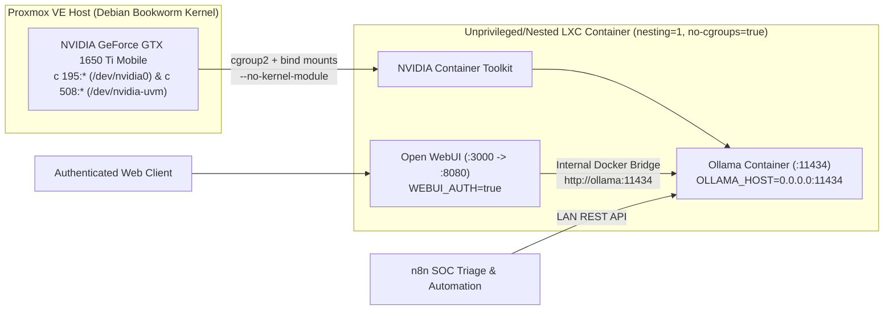

# Local AI Inference Server (Ollama + Open WebUI + GTX 1650 Ti Mobile Passthrough)

A GPU-accelerated local LLM inference stack running **Ollama** and **Open WebUI** via Docker Compose and the **NVIDIA Container Toolkit** inside a **Proxmox VE** LXC container powered by an **NVIDIA GeForce GTX 1650 Ti Mobile** GPU. Serves both interactive authenticated chat and automated REST API endpoints for **n8n** SOC alert triage.

---

## Architecture



---

## Proxmox GPU Passthrough: NVIDIA GeForce GTX 1650 Ti Mobile

Because LXC containers share the Proxmox host kernel, passing the **GTX 1650 Ti Mobile** to containers requires loading the NVIDIA kernel modules on the Proxmox host, exposing the `/dev/nvidia*` character devices via `cgroup2`, and installing user-space libraries inside the LXC with `--no-kernel-module`.

### 1. Proxmox Host Setup & UVM Persistence
```bash
# 1. Install matching kernel headers and build tools on the Proxmox Host
apt update
apt install pve-headers-$(uname -r) build-essential dkms -y

# 2. Blacklist nouveau driver so the host uses the official NVIDIA driver
cat <<EOF > /etc/modprobe.d/blacklist-nouveau.conf
blacklist nouveau
options nouveau modeset=0
EOF
update-initramfs -u

# 3. Ensure NVIDIA kernel modules load automatically at boot (/etc/modules)
cat <<EOF >> /etc/modules
nvidia
nvidia_modeset
nvidia_uvm
EOF

# 4. Create udev rule so /dev/nvidia-uvm nodes initialize automatically on boot
cat <<EOF > /etc/udev/rules.d/70-nvidia.rules
KERNEL=="nvidia", RUN+="/bin/bash -c '/usr/bin/nvidia-smi -L && /bin/chmod 666 /dev/nvidia*'"
KERNEL=="nvidia_uvm", RUN+="/bin/bash -c '/usr/bin/nvidia-modprobe -c0 -u && /bin/chmod 666 /dev/nvidia-uvm*'"
EOF
```

### 2. Inspecting the GTX 1650 Ti Mobile Major Device Numbers
Running `ls -la /dev/nvidia*` on the Proxmox host shell reveals the major device numbers required for LXC `cgroup2` permissions (`195` for standard NVIDIA nodes and `508` for `nvidia-uvm`):
```text
crw-rw-rw- 1 root root 195,   0 /dev/nvidia0
crw-rw-rw- 1 root root 195, 255 /dev/nvidiactl
crw-rw-rw- 1 root root 195, 254 /dev/nvidia-modeset
crw-rw-rw- 1 root root 508,   0 /dev/nvidia-uvm
crw-rw-rw- 1 root root 508,   1 /dev/nvidia-uvm-tools
```

### 3. LXC Container Configuration (`/etc/pve/lxc/<CTID>.conf`)
```ini
arch: amd64
features: nesting=1,keyctl=1
# Allow cgroup2 access to NVIDIA (195), NVIDIA-UVM (508), DRI (226), and FUSE (10:229)
lxc.cgroup2.devices.allow: c 195:* rwm
lxc.cgroup2.devices.allow: c 508:* rwm
lxc.cgroup2.devices.allow: c 226:* rwm
lxc.cgroup2.devices.allow: c 10:229 rwm

# Bind-mount the GTX 1650 Ti Mobile device nodes into the LXC
lxc.mount.entry: /dev/nvidia0 dev/nvidia0 none bind,optional,create=file
lxc.mount.entry: /dev/nvidiactl dev/nvidiactl none bind,optional,create=file
lxc.mount.entry: /dev/nvidia-modeset dev/nvidia-modeset none bind,optional,create=file
lxc.mount.entry: /dev/nvidia-uvm dev/nvidia-uvm none bind,optional,create=file
lxc.mount.entry: /dev/nvidia-uvm-tools dev/nvidia-uvm-tools none bind,optional,create=file
lxc.mount.entry: /dev/dri dev/dri none bind,optional,create=dir
lxc.mount.entry: /dev/fuse dev/fuse none bind,optional,create=file
```

### 4. Inside the LXC Container (`--no-kernel-module` + Docker Toolkit)
```bash
# Push matching driver from Proxmox host to LXC
pct push <CTID> ./NVIDIA-Linux-x86_64-<VERSION>.run /root/NVIDIA-Linux-x86_64-<VERSION>.run

# Inside the LXC: Install user-space driver without kernel modules
chmod +x /root/NVIDIA-Linux-x86_64-<VERSION>.run
./NVIDIA-Linux-x86_64-<VERSION>.run --no-kernel-module

# Configure NVIDIA Container Toolkit for Docker (with no-cgroups enabled for LXC)
nvidia-ctk runtime configure --runtime=docker
sed -i 's/#no-cgroups = false/no-cgroups = true/g' /etc/nvidia-container-runtime/config.toml
systemctl restart docker

# Verify GTX 1650 Ti Mobile is visible inside the container
nvidia-smi
```

---

## Engineering & Troubleshooting Log

### 1. Debian Trixie Repository Conflicts Breaking NVIDIA Driver Compilation
* **Root Cause:** Mixed `apt` repository sources between Debian `trixie` (`testing`) and Proxmox VE kernel headers (`pve-headers-$(uname -r)`) caused unmet dependency errors when building the NVIDIA DKMS module on the host.
* **Fix:** Standardized `/etc/apt/sources.list` onto aligned Debian Bookworm and Proxmox VE No-Subscription repositories, installed matching `pve-headers-$(uname -r)`, and compiled the host driver cleanly.

### 2. Missing `/dev/nvidia-uvm` Node & Major Device Number (`508`) Blocking CUDA in LXC
* **Root Cause:** Even when `/dev/nvidia0` (`c 195:*`) was passed through, CUDA workloads (like Ollama) fell back to CPU because `/dev/nvidia-uvm` (`c 508:*`) was not initialized on the host until `nvidia-modprobe -c0 -u` was invoked, and the LXC lacked `nesting=1` and `/dev/fuse`.
* **Fix:** Added `/etc/udev/rules.d/70-nvidia.rules` on the host to initialize `nvidia-uvm` at boot, enabled `features: nesting=1,keyctl=1`, added `lxc.cgroup2.devices.allow: c 508:* rwm`, and bind-mounted `/dev/nvidia-uvm`, `/dev/nvidia-uvm-tools`, `/dev/nvidia-modeset`, and `/dev/fuse` into `/etc/pve/lxc/<CTID>.conf`.

### 3. Driver Version Mismatch & Kernel Module Conflict Inside LXC
* **Root Cause:** Running a standard `apt install nvidia-driver` inside the LXC attempted to build kernel modules against a shared host kernel and caused version mismatches (`Failed to initialize NVML: Driver/library version mismatch`).
* **Fix:** Installed the exact matching `.run` installer inside the LXC using `--no-kernel-module` and set `no-cgroups = true` in `/etc/nvidia-container-runtime/config.toml` so nested Docker containers could access the **GTX 1650 Ti Mobile** without cgroup permission errors.

### 4. Open WebUI `Connection Refused` When Querying Ollama
* **Root Cause:** Ollama bound exclusively to `127.0.0.1:11434` inside its container, rejecting requests from adjacent Open WebUI and n8n containers.
* **Fix:** Set `OLLAMA_HOST=0.0.0.0:11434` on the Ollama service and pointed Open WebUI to `OLLAMA_BASE_URL=http://ollama:11434`.
