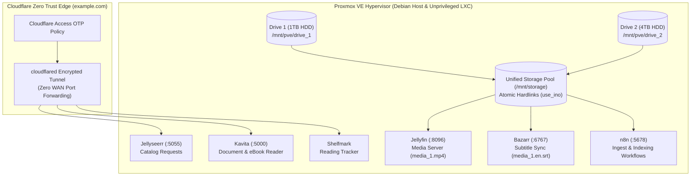

# Proxmox VE Virtualization, Multi-Drive Storage & Media Automation Stack

A containerized self-hosted media streaming, subtitle synchronization, digital document library, and workflow automation stack running inside an isolated Debian LXC/VM environment on a **Proxmox VE** bare-metal hypervisor, protected externally via **Cloudflare Zero Trust Access**.

---

## System & Storage Architecture



### Physical Drive Layout in Proxmox VE
| Identifier | Mount Point | Capacity | Role |
| :--- | :--- | :--- | :--- |
| **Drive 0 (Boot)** | `/` & `local-lvm` | Host OS SSD | Proxmox VE hypervisor root filesystem and LXC/VM system volumes |
| **Drive 1** | `/mnt/pve/drive_1` | 1 TB HDD | Media ingest/staging (`data/`), Proxmox backups (`dump`), LXC templates |
| **Drive 2** | `/mnt/pve/drive_2` | 4 TB HDD | Primary media library (`library/media_1`, `library/media_2`), `nas_share/`, Proxmox backups |
| **Unified Pool** | `/mnt/storage` | 5 TB (`MergerFS`) | Combined virtual mount with `use_ino` enabled for instant atomic hardlinks across folders |

### Sanitized Media & Subtitle Directory Structure
```text
/mnt/storage/
├── ingest/
│   └── media_1/
│       ├── media_1.mp4
│       └── media_1.en.srt
├── library/
│   ├── media_1/
│   │   ├── media_1.mp4
│   │   └── media_1.en.srt
│   └── media_2/
│       ├── media_2.mkv
│       └── media_2.en.srt
├── documents/
└── nas_share/
```

---

## Engineering & Troubleshooting Log

### 1. 4TB Hard Drive (`Drive 2`) Failing to Register at Boot
* **Root Cause:** Late SATA link initialization on the motherboard caused the 4TB hard drive (`/mnt/pve/drive_2`) to spin up after Proxmox had already processed early `/etc/fstab` boot mounts.
* **Fix:** Configured explicit filesystem UUID mounts in `/etc/fstab` with `nofail` and `x-systemd.device-timeout=30s` mount delays so `/mnt/pve/drive_2` mounted reliably at boot without dropping Proxmox into emergency maintenance mode.

### 2. Jellyfin Missing Media Libraries & Container Mount Misalignment (`Drive 1` vs `Drive 2`)
* **Root Cause:** The Jellyfin LXC/Docker environment initially only had a bind mount for `Drive 2` (`mp0: /mnt/pve/drive_2`) and lacked the mount point for the 1TB `Drive 1` (`mp1: /mnt/pve/drive_1`), while internal container paths pointed to a mismatched subfolder. Furthermore, staging files on `Drive 1` while indexing into `Drive 2` triggered cross-device link errors (`EXDEV`), forcing slow full-file SATA copies instead of instant atomic hardlinks.
* **Fix:** Added both `/mnt/pve/drive_1` and `/mnt/pve/drive_2` to `/etc/pve/lxc/<CTID>.conf` (and pooled them via `MergerFS` with `use_ino` into `/mnt/storage`), aligning internal Docker volume mappings so library imports and `.srt` subtitle sidecars (`media_1/media_1.en.srt`) link atomically in milliseconds.

### 3. Permission Denied (`EACCES`) Between Unprivileged LXC and Host Drives
* **Root Cause:** Unprivileged LXC UID/GID shifting (`100000+`) conflicted with root-owned directories on the physical `ext4` hard drives (`Drive 1` and `Drive 2`), preventing media indexing and automated subtitle writes.
* **Fix:** Standardized all container services on `PUID=1000` / `PGID=1000` and aligned host directory ownership (`chown -R 1000:1000` / `101000:101000` for unprivileged LXC mappings).

### 4. Zero-Trust External Access Without WAN Port Forwarding
* **Root Cause:** Exposing self-hosted web services via traditional router NAT port forwarding exposes residential IP addresses and internal ports to internet-wide scanners.
* **Fix:** Exposed `Jellyseerr`, `Kavita`, and `Shelfmark` under `example.com` subdomains via **Cloudflare Zero Trust Tunnels (`cloudflared`)** fronted by **Cloudflare Access OTP policies**, eliminating all public WAN port exposure on the perimeter firewall.
