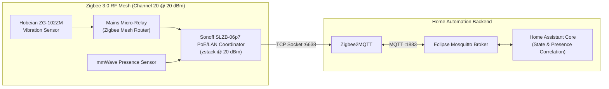

# Smart Home Automation (Home Assistant + Zigbee2MQTT + SLZB-06p7)

Local **Home Assistant** instance integrated with **Zigbee2MQTT** and an **Eclipse Mosquitto** MQTT broker, coordinating a **Sonoff SLZB-06p7** PoE/LAN network coordinator, mmWave human presence sensors, **Hobeian ZG-102ZM** vibration sensors, and mains-powered custom micro-relays.

## Architecture

## Engineering & Troubleshooting Log

### 1. Zigbee Signal Dropouts Through Thick Concrete Apartment Walls
* **Root Cause:** High RF signal attenuation across thick interior concrete walls caused battery-powered end devices (like the Hobeian ZG-102ZM vibration sensor) to drop off the mesh.
* **Fix:** Deployed the **Sonoff SLZB-06p7** Ethernet/PoE coordinator positioned centrally over LAN (`tcp://<COORDINATOR_IP>:6638`), boosted transmit power to `20 dBm`, switched to Zigbee **Channel 20** (avoiding 2.4GHz Wi-Fi interference on channels 1 and 6), and used mains-powered micro-relays as Zigbee mesh routers.

### 2. Hobeian ZG-102ZM Vibration Sensor False Alarms
* **Root Cause:** Tuya ZG-102ZM sensors triggered on minor ambient vibrations or when someone was simply walking around the room.
* **Fix:** Calibrated sensitivity inside Zigbee2MQTT and combined the vibration trigger with an **mmWave presence sensor** state condition (`binary_sensor.room_mmwave_presence == 'off'`) in Home Assistant so alerts only fire when vibration occurs while the room is vacant.

### 3. SLZB-06p7 TCP Socket Drops & Reconnection Watchdog
* **Root Cause:** Operating the coordinator over TCP (`tcp://<COORDINATOR_IP>:6638`) bypasses physical USB passthrough limits in Proxmox, but brief LAN switch glitches can drop the remote serial socket.
* **Fix:** Configured explicit `zstack` adapter parameters and TCP keepalive/reconnection settings so Zigbee2MQTT recovers automatically without manual container restarts.
